<div align="center">

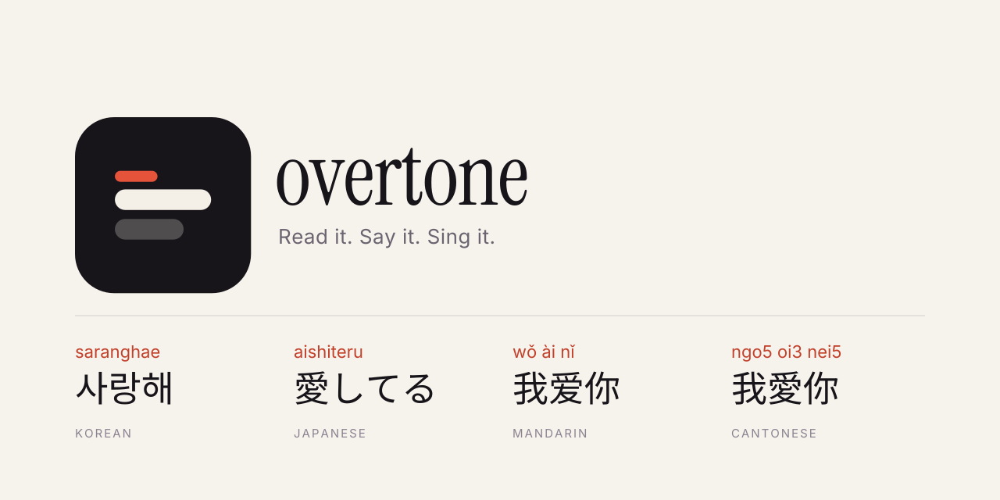

# Overtone

**Learn the songs you love: read the lyrics, understand every word, and sing along.**
A local-first lyrics learner for Korean, Japanese, Mandarin and Cantonese.

<p>
  <a href="LICENSE"></a>
  <a href="#install-it">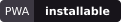</a>
  <a href="#principles"></a>
  <a href="#principles">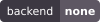</a>
  <a href="#principles">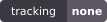</a>
  
  <br>
  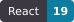
  
  
  
</p>

[Features](#features) · [Screenshots](#screenshots) · [Install it](#install-it) · [Run it locally](#run-it-locally) · [Deploy](#deploy-your-own) · [How it works](#how-it-works) · [Contributing](CONTRIBUTING.md)

</div>

---

## Why Overtone?

Singing along in a language you are still learning is slow: you hunt for a romanisation, paste words into a dictionary, and lose your place. Overtone puts all of it on one screen. Paste the lyrics (or pull them from the free LRCLIB database), and every word gets its pronunciation, its meaning on a tap, and a progress check you can tick off line by line.

It is designed first for the **iPhone Home Screen**, works **fully offline**, needs **no account and no server**, and never sends your songs anywhere.

## Features

| | |
|---|---|
| **Learn** | Pronunciation above every word: furigana and romaji for Japanese, pinyin for Mandarin, Jyutping for Cantonese, Revised Romanization for Korean. Mixed-language lines work, with English kept in the same reading row. Tick lines off as you learn them. |
| **Word meanings** | Tap any word for its dictionary form, part of speech and senses, from offline dictionaries (JMdict, CC-CEDICT, CC-Canto, Wiktionary, kengdic). Missing entries say so honestly instead of guessing. |
| **Corrections** | Reading wrong? Fix a reading, add your own meaning, split or merge words, or mark a word as English. Corrections survive lyric edits and show in every mode. |
| **Karaoke** | Big, clean romanised text to sing from. Korean can be split into syllables (`sa-rang-hae`), following real sound changes. Keeps the screen awake. |
| **Clean** | A plain, selectable layout, original or romanised. |
| **Your library** | Search by title, artist, lyrics or romanisation (`saranghae` finds 사랑해). Per-song progress, backups as one JSON file, and a recovery screen if a browser clears storage. |
| **Optional lyric search** | Search LRCLIB from inside the app. Pasting lyrics always works with no network. |
| **Romanised lyrics** | Paste romanised Korean or Japanese and review a suggested original-script version (Hangul, or kana without kanji). Nothing changes until you accept, and Mandarin/Cantonese are not supported. |
| **Private by design** | No analytics, no third-party scripts or fonts, a strict content security policy. Network calls go only to the app's own origin and, when you use search, `lrclib.net`. |

## Screenshots

<div align="center">

| Learn | Karaoke | Word sheet |
| :---: | :---: | :---: |
| 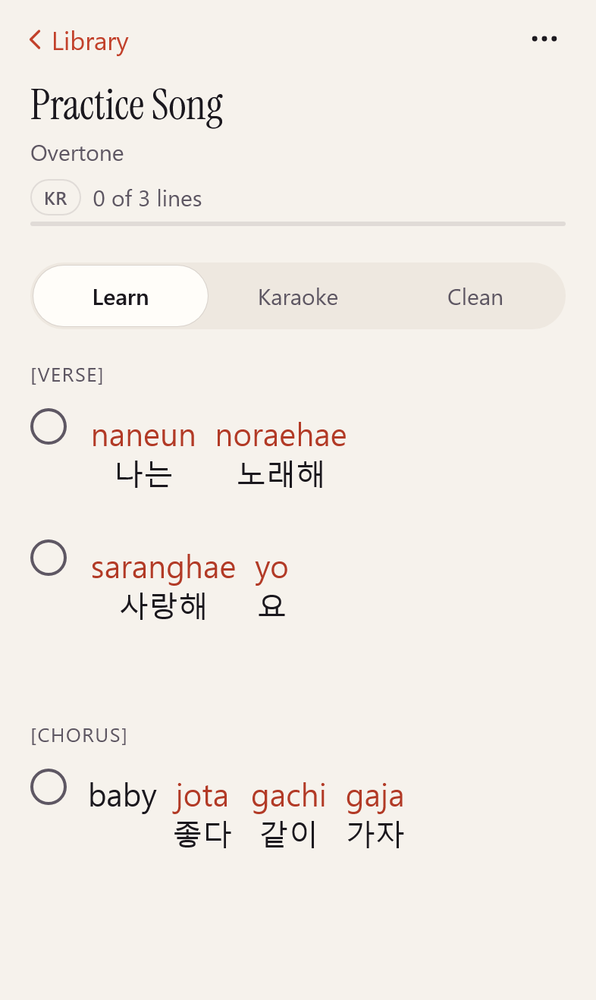 | 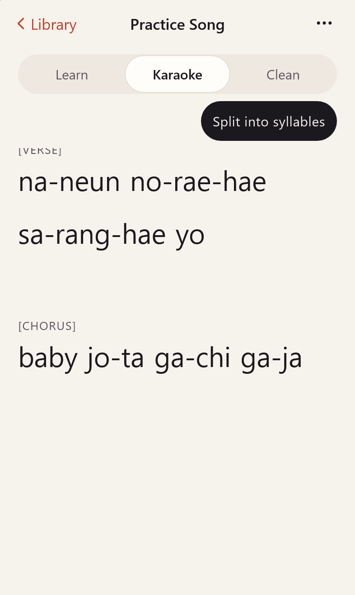 | 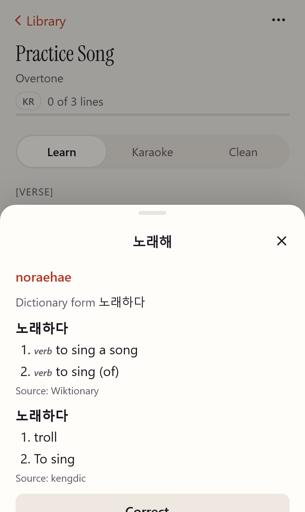 |

| Library | Add song | Settings |
| :---: | :---: | :---: |
| 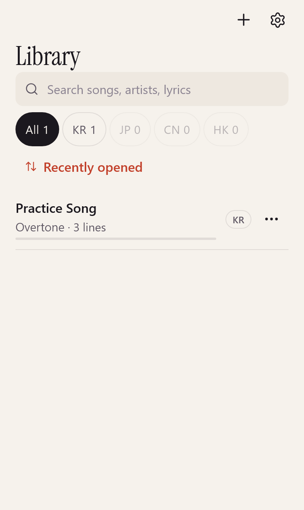 | 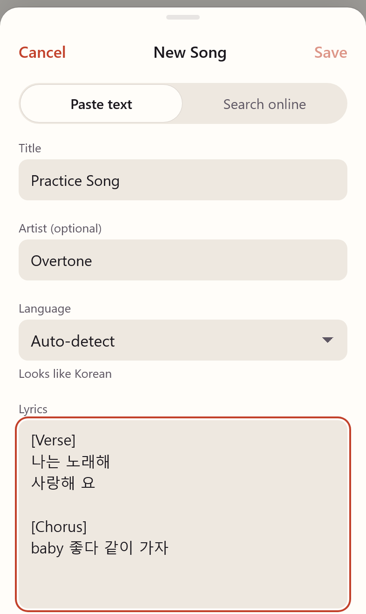 | 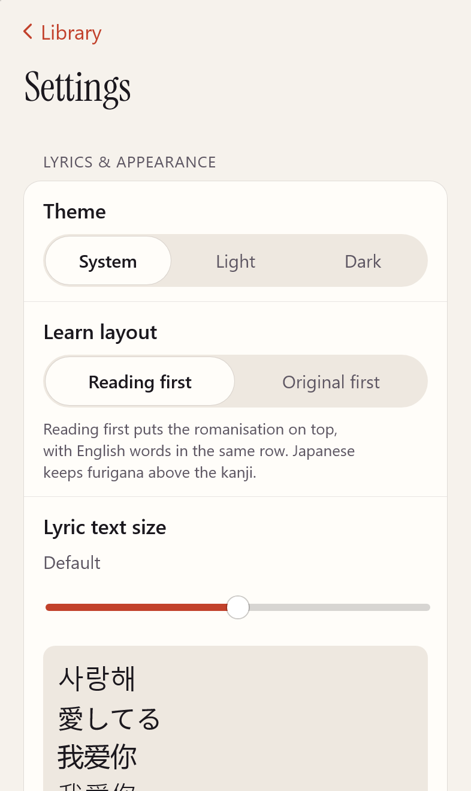 |

</div>

The practice text in the screenshots was written for this project; it is not a real song.

## Install it

Open your deployed copy in Safari on an iPhone, tap **Share → Add to Home Screen**, then launch it from the Home Screen. Do this before relying on it: an installed app gets its own storage and is much less likely to be cleared. It also works in Chrome and on the desktop.

**Back up your songs.** Settings → Backup & storage → Export backup saves one JSON file you can import on any device. Overtone reminds you after a week of unsaved changes.

## Principles

- **Local-first.** Songs, progress, corrections and settings live in IndexedDB on your device.
- **Offline-first.** After the first visit the app shell works with no network. Language data is downloaded once (from the same site) and then used offline.
- **No backend.** It is a folder of static files. Free to host anywhere.
- **Honest about accuracy.** Pronunciation comes from established open libraries and dictionaries. Uncertain readings are marked, and anything can be corrected. See [accuracy and limits](#accuracy-and-limits).

## Run it locally

Node 22 or newer.

```bash
git clone https://github.com/DefinitivedCode/Overtone.git
cd Overtone
npm ci
npm run packs   # builds the language packs into public/packs (first run downloads ~240 MB of sources)
npm run dev     # http://localhost:5173
```

| Script | What it does |
|---|---|
| `npm run verify` | packs, lint, typecheck, unit tests, production build, Playwright (WebKit + Chromium) |
| `npm run test:ling` | linguistic accuracy and dictionary coverage suites |
| `npm run brand` | regenerate icons, splash screens and the banner from `brand/*.svg` |
| `npm run licences` | regenerate the About & licences data |

Install the browsers for the end-to-end tests once with `npx playwright install chromium webkit`.

## Deploy your own

The build is static. `npm run build` also writes `dist/_headers` (strict CSP, `nosniff`, immutable caching for hashed assets and versioned packs) for Cloudflare Pages and Netlify.

```bash
npm run packs && npm run build
npx wrangler pages deploy dist --project-name overtone    # Cloudflare Pages
```

For GitHub Pages use a base path: `VITE_BASE=/<repo>/ npm run build`, then publish `dist/`. Build locally rather than on a build server, because the packs download large source files.

## How it works

- **Language engine** (`src/engine`): runs in a Web Worker. Korean uses its own rule-based romaniser; Japanese uses Lindera/IPADIC (WASM) with Hepburn and furigana alignment; Mandarin uses pinyin-pro and a CC-CEDICT max-match segmenter; Cantonese uses to-jyutping with CC-Canto.
- **Language packs** (`scripts/packs`): dictionaries are built from pinned, checksummed upstream sources into versioned files that install into IndexedDB in blocks.
- **Corrections** are a render-time overlay, so editing never re-runs analysis and Learn, Karaoke and Clean update together.
- **PWA**: a small generated service worker precaches the shell (about 1.6 MiB) and serves packs cache-first.

Architecture decisions, with measurements, are in [`docs/adr`](docs/adr). The original plan is in [`planning/`](planning/README.md).

## Accuracy and limits

- Every linguistic test fixture was written by the project author, **not reviewed by a fluent speaker**, so scores are consistency checks, not proof of native-level accuracy. Details in [`docs/LINGUISTIC_REPORT.md`](docs/LINGUISTIC_REPORT.md).
- Japanese gives one contextual reading per word; rare names and poetic readings may need correcting.
- **Manual testing on a physical iPhone has begun** using the deployed PWA. The Library, Add Song, Learn, Karaoke and word-definition interfaces have been exercised; this testing revealed sheet presentation and scroll-position issues ([#1](https://github.com/DefinitivedCode/Overtone/issues/1), [#2](https://github.com/DefinitivedCode/Overtone/issues/2)). Full iOS verification, including installation, offline operation and updates, is not yet confirmed. See [`docs/IOS_VERIFICATION.md`](docs/IOS_VERIFICATION.md).
- Full list: [`docs/KNOWN_LIMITATIONS.md`](docs/KNOWN_LIMITATIONS.md).

## Documentation

[`PROGRESS`](docs/PROGRESS.md) · [`KNOWN_LIMITATIONS`](docs/KNOWN_LIMITATIONS.md) · [`LINGUISTIC_REPORT`](docs/LINGUISTIC_REPORT.md) · [`TRACEABILITY`](docs/TRACEABILITY.md) · [`RELEASE`](docs/RELEASE.md) · [`IOS_VERIFICATION`](docs/IOS_VERIFICATION.md)

## Licences and credits

- **Overtone's source code** is released under the [MIT License](LICENSE).
- **Language data is not MIT.** The dictionaries downloaded by the app are under CC BY-SA family licences (JMdict, CC-CEDICT, CC-Canto, Wiktionary, kengdic), and the Japanese tokenizer uses IPADIC terms. Attribution is shown in the app under **Settings → About & licences** (generated by `npm run licences`) and in `scripts/packs/sources.json`. If you redistribute built packs, the ShareAlike terms apply to them.
- **Instrument Serif** is under the SIL Open Font License.
- **Lyrics** belong to their owners. Overtone ships none and stores only what you add or explicitly save from LRCLIB, for personal study.

Made by [DefinitivedCode](https://github.com/DefinitivedCode).
